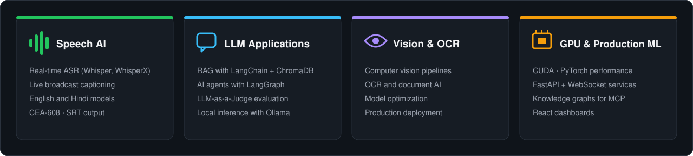

  

  

  
  
  

---

## 👋 About Me

I'm an **AI/ML Engineer with 5+ years of experience** designing, optimizing and deploying **production-grade AI systems**, currently at **Planetcast Media Services**.

- 🎙️ I build **real-time speech recognition** systems, including live GPU captioning for sports broadcasts
- 🧠 I build **LLM applications**: RAG pipelines, AI agents and LLM evaluation frameworks
- 👁️ I work on **computer vision and OCR** in production
- ⚡ I care about **performance**: CUDA, GPU utilization, latency and cost
- 🔒 I like **local-first AI**: private, fast, and with no API bills

  

## 🛠️ Tech Stack

  

  
  
  
  
  
  
  
  
  
  

## 🚀 Featured Projects

<table>
  <tr>
    <td width="50%" valign="top">
      
      <h3><a href="https://github.com/tabhiabhishek/captionflow-pro">CaptionFlow Pro</a></h3>
      Real-time GPU captioning for live cricket broadcasts. WhisperX in English and Hindi, cricket-aware corrections, CEA-608 output.
        <code>WhisperX</code> <code>PyTorch</code> <code>FastAPI</code> <code>React</code>
    </td>
    <td width="50%" valign="top">
      
      <h3><a href="https://github.com/tabhiabhishek/Graphify_Plus">Graphify Plus</a></h3>
      Turns any codebase into a knowledge graph that AI coding assistants query over MCP, using far fewer tokens.
        <code>MCP</code> <code>NetworkX</code> <code>SQLite FTS5</code> <code>Ollama</code>
    </td>
  </tr>
  <tr>
    <td width="50%" valign="top">
      
      <h3><a href="https://github.com/tabhiabhishek/Speech-AI">Speech AI Assistant</a></h3>
      Record a voice note, transcribe it on the GPU and let a local LLM summarize it, translate it or extract action items.
        <code>faster-whisper</code> <code>Ollama</code> <code>CUDA</code> <code>Streamlit</code>
    </td>
    <td width="50%" valign="top">
      
      <h3><a href="https://github.com/tabhiabhishek/RAG-Assistant">Local RAG Assistant</a></h3>
      Private "chat with your PDF" app. Answers come with source pages, and no data leaves your machine.
        <code>LangChain</code> <code>ChromaDB</code> <code>Ollama</code> <code>Streamlit</code>
    </td>
  </tr>
  <tr>
    <td width="50%" valign="top">
      
      <h3><a href="https://github.com/tabhiabhishek/LangGraph-Agent">LangGraph Agent</a></h3>
      A local ReAct agent that searches the live web and solves math with tools, and shows its reasoning step by step.
        <code>LangGraph</code> <code>Llama 3.2</code> <code>DuckDuckGo</code>
    </td>
    <td width="50%" valign="top">
      
      <h3><a href="https://github.com/tabhiabhishek/RAG-Evaluation">RAG Evaluation</a></h3>
      LLM-as-a-Judge scoring for prompt versions on Faithfulness, Relevance and Context Precision.
        <code>Qwen 2.5</code> <code>PyYAML</code> <code>Pandas</code>
    </td>
  </tr>
</table>

## 📊 GitHub Stats

  
  

  

## 🐍 Contribution Graph

  <picture>
    <source media="(prefers-color-scheme: dark)" srcset="https://raw.githubusercontent.com/tabhiabhishek/tabhiabhishek/output/github-snake-dark.svg">
    <source media="(prefers-color-scheme: light)" srcset="https://raw.githubusercontent.com/tabhiabhishek/tabhiabhishek/output/github-snake.svg">
    
  </picture>

## 🌱 Currently

- 🔭 Working on **real-time multilingual captioning** for live broadcasts
- 🧪 Exploring **agentic RAG** and **LLM evaluation** for production
- 📚 Learning more about **GPU inference optimization** (quantization, batching, streaming)
- 💬 Ask me about **Whisper, RAG, LangGraph or CUDA performance**

## 🤝 Let's Connect

  
  

⭐ If you find a project useful, a star helps a lot!

